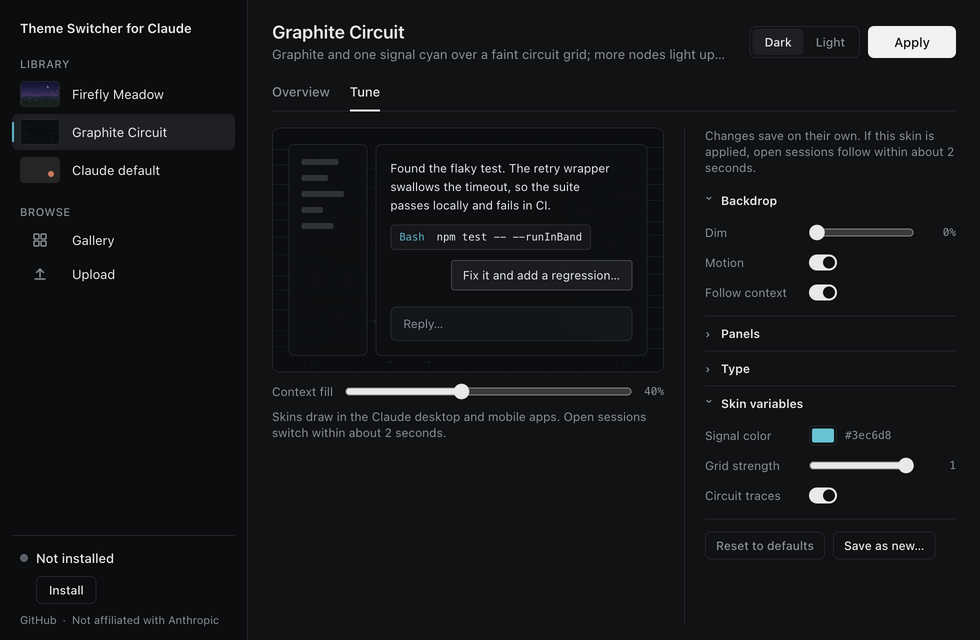
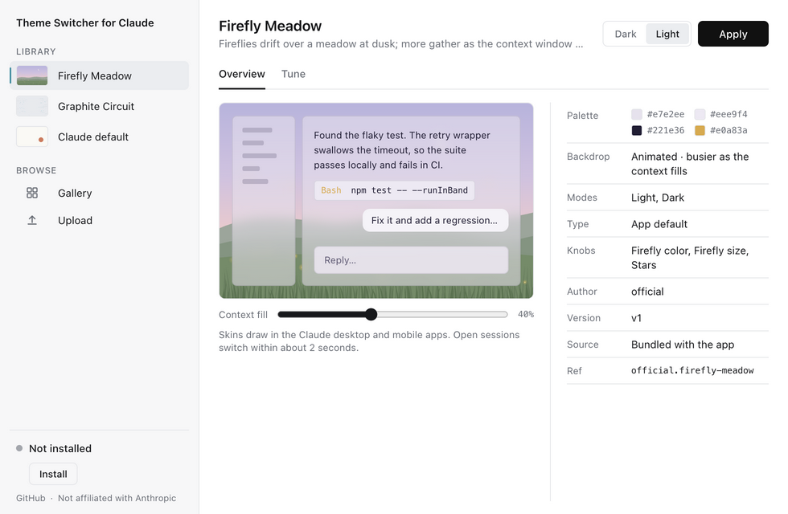
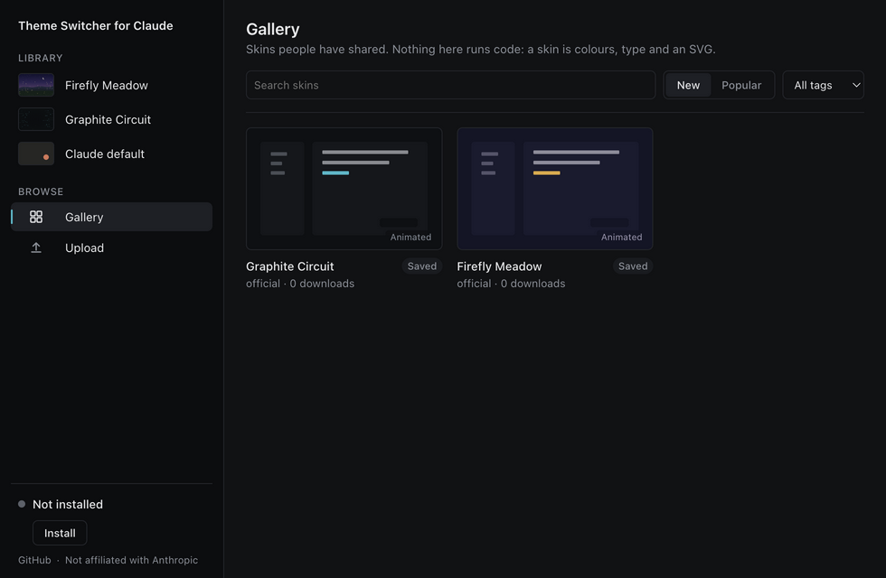

# Theme Switcher for Claude

A desktop app for macOS and Windows that reskins the Claude desktop app. It comes with a public gallery where anyone can share skins, and a bridge plugin that draws the skin you pick.



- **Skins**: colors, type, message style, and an optional animated backdrop that gets busier as the conversation's context window fills.
- **Tune anything**: backdrop dim, frosted-panel blur and opacity, motion, accent color, text size, bubble radius, plus the knobs each skin declares (glow color, grid strength, …). A live preview shows the result before you apply it.
- **Gallery**: browse, search and save skins other people shared. Sign in with GitHub to upload your own, or save your current tuning as a new skin, no code needed.
- **Safe by design**: a skin is data only (a JSON file and an SVG). Nothing in a skin runs code, and the gallery, the app and Claude each refuse scripts, external links and embedded content.

> Not affiliated with Anthropic. Skins draw in the Claude desktop (and mobile) app; the terminal keeps its own look.

| | |
| --- | --- |
|  |  |

## Install

1. Download the installer for your system from [Releases](https://github.com/Bowen1314/claude-theme-switcher/releases): `.dmg` for macOS, `.exe` for Windows.
   The builds are not code-signed yet:
   - **macOS**: right-click the app, choose **Open**, then **Open** again. If macOS says the app is damaged, run `xattr -cr "/Applications/Theme Switcher for Claude.app"` once.
   - **Windows**: if SmartScreen appears, click **More info → Run anyway**.
2. Open the app and click **Install** to add the bridge plugin to Claude Code.
3. Start a new Claude session (sessions that were already open don't load new plugins), then pick a skin and click **Apply**. Open sessions follow within a couple of seconds.

### Built-in skins

| Skin | |
| --- | --- |
| **Firefly Meadow** | Fireflies drifting over a meadow at dusk, violet night and firefly gold. More fireflies gather as the context fills. |
| **Graphite Circuit** | Graphite surfaces, one signal cyan, a faint circuit grid, hairline borders and mono headings. More circuit nodes light up as the context fills. |
| **Claude default** | The app's own look. |

## Sharing a skin

- **From the app**: tune a skin, choose **Save as new…**, then go to **Upload**, sign in with GitHub and pick it.
- **By hand**: write a folder with `skin.json` (and optionally `scene.svg`) following [docs/skin-format.md](docs/skin-format.md), then use **Upload → Import folder…**. The app runs the same checks as the gallery and shows every problem before anything is sent.

Uploads are public and appear under your GitHub login, at most 10 a day. Uploading the same slug again publishes a new version. Signing in only proves who you are: the app asks GitHub for no permissions and keeps the sign-in encrypted on your computer.

The gallery server lives in [`server/`](server/) (a Cloudflare Worker with D1); [`server/README.md`](server/README.md) documents its API. Skins that three different people report are hidden until reviewed.

## Plugin only (no app)

At the prompt of a Claude Code terminal session:

```
/plugin install theme-switcher --marketplace Bowen1314/claude-theme-switcher
```

Then pick a skin by writing `~/.claude-theme-switcher/selection.json` (`%USERPROFILE%\.claude-theme-switcher\selection.json` on Windows):

```json
{ "theme": "official.graphite-circuit", "settings": { "official.graphite-circuit": { "dim": 0.2 } } }
```

`theme` is a skin ref (`official.firefly-meadow`, `official.graphite-circuit`, or `<owner>.<slug>` for a skin in `~/.claude-theme-switcher/skins/`) or `default`. [docs/skin-format.md](docs/skin-format.md) lists every setting.

## How it works

Custom looks in Claude are set by plugins, so the app doesn't change Claude directly:

- The app keeps skins in `~/.claude-theme-switcher/skins/<ref>/` and writes your pick and settings to `~/.claude-theme-switcher/selection.json`.
- The bridge plugin (`plugin/`), running inside each Claude session, checks that file every 1.5 seconds. It turns the skin's colors into a full theme, writes your settings into the backdrop SVG, and applies it. It writes a heartbeat to `bridge.json`, which the app reads to show whether the bridge is connected.
- Backdrops are plain animated SVG. Elements marked `data-ctx="0.35"` appear once the context window is 35% full; the bridge also passes the fill and each skin variable in as CSS variables.

## Layout

```
app/       Electron app (library, tuning, gallery, upload)
plugin/    the bridge plugin and the built-in skins
shared/    skin validator used by the app and the server
server/    gallery API (Cloudflare Worker + D1)
docs/      skin format
```

## Development

```
cd app && npm install && npm start     # run the app
cd app && npm test                     # app tests
cd shared && npm test                  # validator tests
cd server && npm test                  # server tests (Node 22.13+)
claude plugin test plugin              # plugin tests
claude plugin validate .               # marketplace + plugin
```

Pushing a `v*` tag builds the macOS and Windows installers in GitHub Actions and attaches them to a release.

## License

MIT © 2026 Soso Technologies LLC
