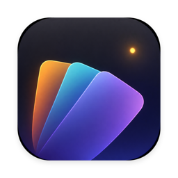
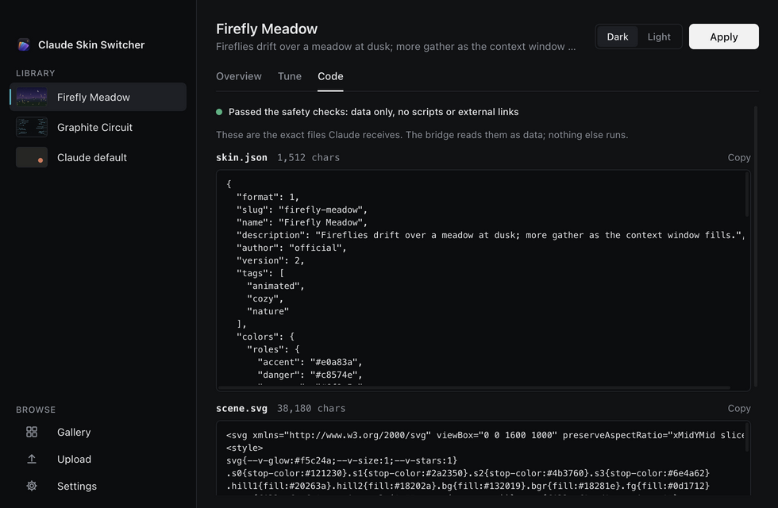
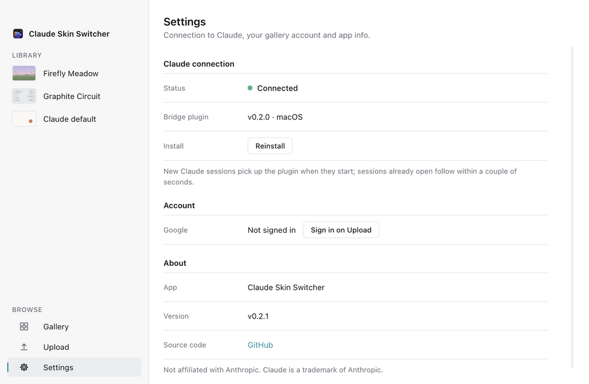

<div align="center">



# Claude Skin Switcher

**A free desktop app for macOS and Windows that reskins the Claude desktop app: pick a skin, tune every detail with a live preview, and share it in a public gallery.**

[](https://github.com/Bowen1314/claude-skin-switcher/releases/latest)
[](LICENSE)
[](https://github.com/Bowen1314/claude-skin-switcher/releases/latest)
[](https://github.com/Bowen1314/claude-skin-switcher/actions/workflows/ci.yml)
[](#plugin-only-no-app)

English | [中文](README_CN.md)

[Website](https://bowen1314.github.io/claude-skin-switcher/) · [Install](#install) · [Features](#features) · [Screenshots](#screenshots) · [Make a skin](#make-and-share-a-skin) · [Docs](#documentation)

</div>

<p align="center">
  
</p>

## Before you start

- **Not made by Anthropic.** Claude Skin Switcher is an independent open-source project. Claude is a trademark of Anthropic.
- **The installers are not code-signed yet.** macOS and Windows warn you the first time you open the app; [Install](#install) shows how to get past it.
- **Uploads are public.** A skin you upload appears in the gallery under the public name you choose, for anyone to download.
- **Skins draw in the Claude desktop and mobile apps.** The Claude Code terminal keeps its own look.

## Who it's for

**For:**

- customizing Claude's colors, animated backdrop, type and message style;
- fine-grained tuning with a preview before anything reaches Claude;
- sharing skins, or using other people's, without writing code.

**Not for:**

- changing what Claude does: a skin changes only its appearance;
- the Claude Code terminal.

## Features

- **Skin library.** Firefly Meadow and Graphite Circuit come built in, plus Claude's own default look. Skins you download or make sit in the same list; pick one and click **Apply**.
- **Draft-based tuning.** Backdrop dim, motion on or off, whether the backdrop follows the conversation, frosted-panel blur and opacity, accent color, text size and message-bubble radius, plus the knobs each skin declares (glow color, grid strength, …). Changes stay a draft that only the preview shows until you click **Apply changes**; **Discard** throws them away.
- **Context-reactive backdrops.** Backdrops gain detail as the context window fills.
- **Public gallery.** Browse, search and filter skins by tag, open one for its details, and download it in one click. [More](docs/gallery-and-privacy.md)
- **Inspectable code.** Every skin, local or in the gallery, has a **Code** tab with its exact `skin.json` and `scene.svg` as plain text, plus the result of the safety checks. What you read is what Claude receives.
- **Upload with Google.** Sign in with Google to share a skin under a public name you choose. The app asks Google for the `openid` scope only, so the gallery never sees your email or name. [Privacy](docs/gallery-and-privacy.md#what-is-stored)
- **Save as new.** Save the current tuning as a separate skin and upload it, no code required.
- **Safe by design.** A skin is data: a JSON file and an SVG drawing. Scripts, external links and embedded content are refused by the gallery on upload, by the app on download, by the plugin, and by Claude itself. [Security design](docs/security.md)
- **Native feel.** No title bar, light and dark themes, English and Chinese (follows the system or set in **Settings**), and a Settings page with the Claude connection status and one-click plugin install.
- **In-app updates.** The app checks GitHub Releases for a new version and installs it when you click **Update** in **Settings → About**. Every download is checked against the release's SHA-512 checksum first.

## Screenshots

<table>
  <tr>
    <td width="50%" valign="top">
      <br>
      <sub>Library: details, palette, and a live preview</sub>
    </td>
    <td width="50%" valign="top">
      <br>
      <sub>Gallery: search, filter by tag, download in one click</sub>
    </td>
  </tr>
  <tr>
    <td width="50%" valign="top">
      <br>
      <sub>Code: the exact files Claude receives, with the safety check result</sub>
    </td>
    <td width="50%" valign="top">
      <br>
      <sub>Settings: Claude connection, account, and app info</sub>
    </td>
  </tr>
</table>

## Install

### 1. Download

Get the installer for your system from [Releases](https://github.com/Bowen1314/claude-skin-switcher/releases/latest):

| System | File |
|---|---|
| macOS, Apple silicon (M1 and later) | `claude-skin-switcher-<version>-mac-arm64.dmg` |
| macOS, Intel | `claude-skin-switcher-<version>-mac-x64.dmg` |
| Windows 10 / 11 | `claude-skin-switcher-<version>-win-x64.exe` |

### 2. Open it the first time

The builds are not code-signed yet:

- **macOS**: drag the app to Applications, right-click it, choose **Open**, then **Open** again. If macOS says the app is damaged, run this once in Terminal:

  ```bash
  xattr -cr "/Applications/Claude Skin Switcher.app"
  ```

  The first time you sign in, macOS asks whether the app may use "Claude Skin Switcher Safe Storage" in your keychain. That is the app's own key for keeping your sign-in encrypted: enter your Mac password and choose **Always Allow**.
- **Windows**: if SmartScreen appears, click **More info → Run anyway**.

### 3. Connect it to Claude

1. In the app, open **Settings** and click **Install** next to the Claude connection. This adds the bridge plugin to Claude Code.
2. Start a new Claude session. Sessions that were already open don't load new plugins.
3. Pick a skin and click **Apply**. Open sessions follow within about 2 seconds, and **Settings** shows **Connected**.

Later versions update from **Settings → About**: click **Update** when a new version is listed. On macOS this works when the app is in Applications (or another folder you can write to), not when it runs from the disk image.

## Make and share a skin

- **From the app**: tune a skin, choose **Save as new…**, then open **Upload**, sign in with Google (the first time you also choose your public name), and pick it. Uploading the same skin again publishes a new version; at most 10 uploads a day.
- **By hand**: write a folder with `skin.json` and, optionally, `scene.svg` following [docs/skin-format.md](docs/skin-format.md), then use **Upload → Import folder…**. The app runs the same checks as the gallery and lists every problem before anything is sent.

Only skins you made can be uploaded: skins downloaded from the gallery stay out of the upload list, and copies are refused (for skins with a backdrop, even recolored or renamed). A skin saved as new from someone else's is uploaded as a remix that credits the original. Skins that several people report are hidden until reviewed, and you can delete your own uploads at any time. [More](docs/gallery-and-privacy.md)

## Plugin only (no app)

At the prompt of a Claude Code terminal session:

```
/plugin install theme-switcher --marketplace Bowen1314/claude-skin-switcher
```

Then pick a skin by writing `~/.claude-theme-switcher/selection.json` (`%USERPROFILE%\.claude-theme-switcher\selection.json` on Windows):

```json
{ "theme": "official.graphite-circuit", "settings": { "official.graphite-circuit": { "dim": 0.2 } } }
```

`theme` is a skin ref (`official.firefly-meadow`, `official.graphite-circuit`, or `<author>.<slug>` for a skin in `~/.claude-theme-switcher/skins/`) or `default`. [docs/skin-format.md](docs/skin-format.md) lists every setting.

## How it works

Custom looks in Claude are drawn by plugins, so the app never touches Claude itself:

- The app keeps skins in `~/.claude-theme-switcher/skins/<ref>/` and writes your pick and settings to `~/.claude-theme-switcher/selection.json` when you click **Apply**.
- The bridge plugin, running inside each Claude session, checks that file every 1.5 seconds. It turns the skin's colors into a full theme, writes your settings into the backdrop SVG, and applies it. It also writes a heartbeat the app reads to show whether Claude is connected.
- Backdrops are plain animated SVG. An element marked `data-ctx="0.35"` appears once the context window is 35% full, and each skin variable reaches the SVG as a CSS variable.

## Documentation

- [Skin format](docs/skin-format.md): every field of `skin.json`, the SVG rules, variables and limits
- [Security design](docs/security.md): why a skin can't run code, the four layers of checks, and what is still possible
- [Gallery and privacy](docs/gallery-and-privacy.md): sign-in, public names, uploads, reports, what is stored
- [Gallery API](server/README.md): the Cloudflare Worker's endpoints, limits and deployment
- [Privacy policy](https://bowen1314.github.io/claude-skin-switcher/privacy.html) · [Terms](https://bowen1314.github.io/claude-skin-switcher/terms.html)

## Development

```
app/       Electron app (library, tuning, gallery, upload, settings)
plugin/    the bridge plugin and the built-in skins
shared/    skin validator used by the app and the server
server/    gallery API (Cloudflare Worker + D1)
site/      project website (GitHub Pages)
docs/      skin format, security, gallery and privacy
```

```bash
cd app && npm install && npm start     # run the app
cd app && npm test                     # app tests
cd shared && npm test                  # validator tests
cd server && npm test                  # server tests (Node 22.13+)
claude plugin test plugin              # plugin tests
claude plugin validate .               # marketplace + plugin
```

Pushing a `v*` tag builds the macOS and Windows installers in GitHub Actions and attaches them to a release. Changes under `site/` deploy the website to GitHub Pages.

## License

MIT © 2026 Soso Technologies LLC. See [LICENSE](LICENSE).

Not affiliated with Anthropic. Claude is a trademark of Anthropic.
