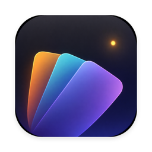
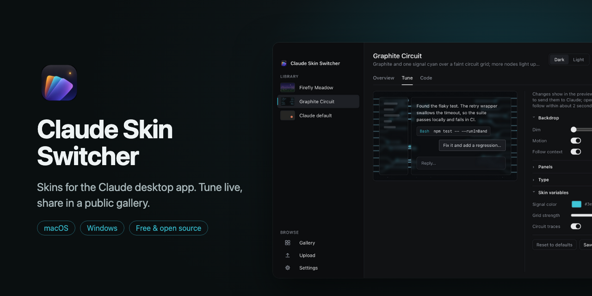
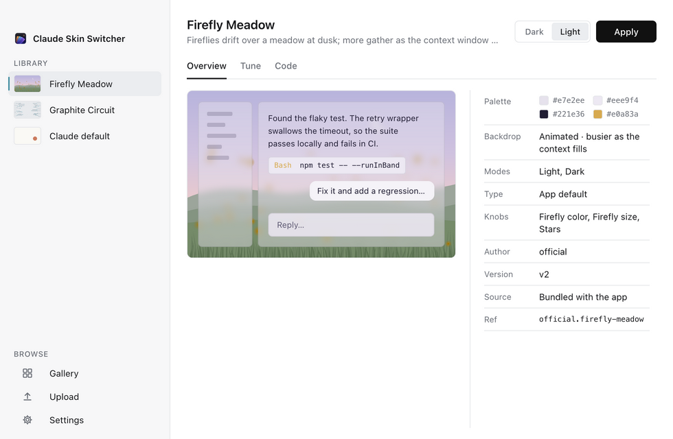
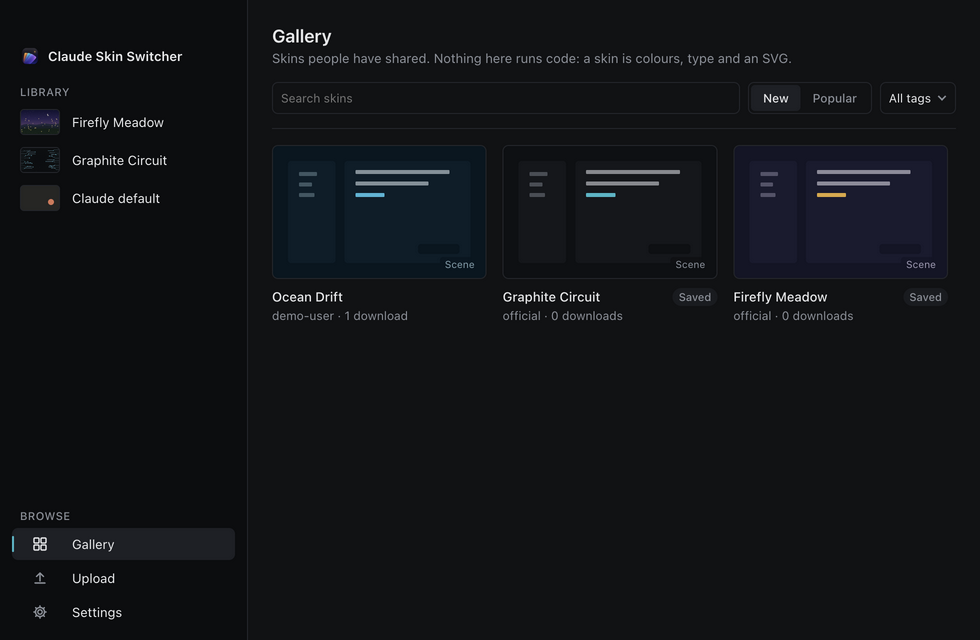
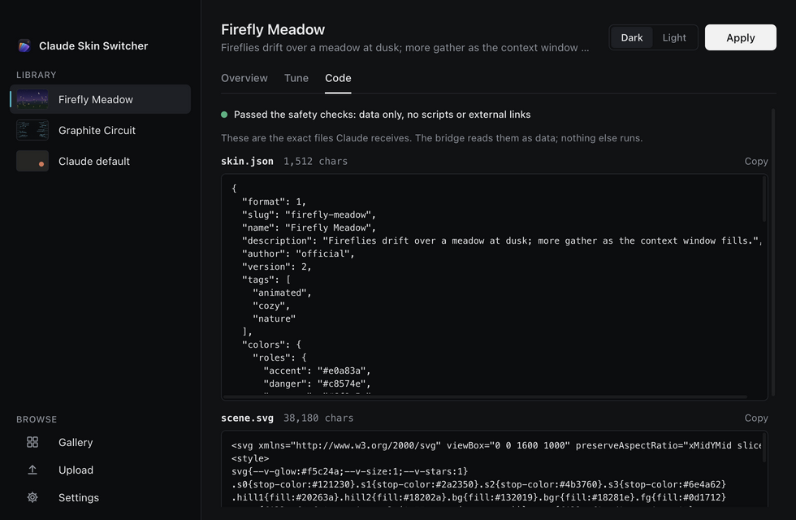
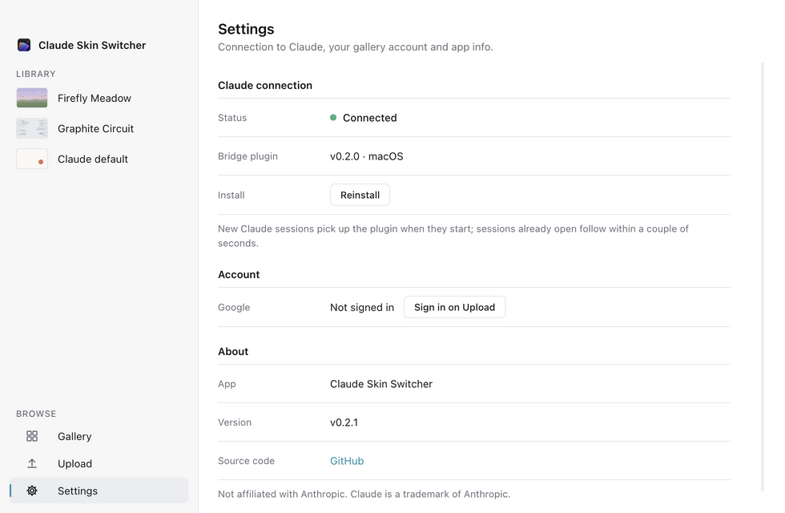

<div align="center">



# Claude Skin Switcher

**Claude 桌面版皮肤切换器。免费，支持 macOS 与 Windows：选择皮肤、实时预览调整、发布到公开画廊。**

[](https://github.com/Bowen1314/claude-skin-switcher/releases/latest)
[](LICENSE)
[](https://github.com/Bowen1314/claude-skin-switcher/releases/latest)
[](https://github.com/Bowen1314/claude-skin-switcher/actions/workflows/ci.yml)
[](#仅安装插件)

[English](README.md) | 中文

[官网](https://bowen1314.github.io/claude-skin-switcher/) · [安装](#安装) · [功能](#功能) · [截图](#截图) · [制作皮肤](#制作与分享) · [文档](#文档)

</div>

<p align="center">
  
</p>

## 使用须知

- **非 Anthropic 官方产品。** 本项目为独立开源项目，Claude 是 Anthropic 的商标。
- **安装包未签名。** 首次打开时系统会提示风险，放行方法见[安装](#安装)。
- **上传内容公开。** 上传的皮肤以你设定的公开名展示，所有人可下载。
- **仅作用于 Claude 桌面版与移动版。** Claude Code 终端界面不受影响。

## 适用范围

**适用于：**

- 自定义 Claude 的配色、动态背景、字体与消息样式；
- 需要精细调整，并在生效前预览效果；
- 分享自己的皮肤或使用他人作品，且不编写代码。

**不适用于：**

- 改变 Claude 的功能或行为：皮肤只改外观；
- Claude Code 终端版。

## 功能

- **皮肤库。** 内置 Firefly Meadow、Graphite Circuit 与 Claude 默认外观；下载和自制的皮肤统一管理，选中后点击 **应用**。
- **草稿式调整。** 背景暗度、动画、背景随对话变化、面板模糊与不透明度、强调色、字号、气泡圆角，以及皮肤自定义参数。改动仅在预览中生效，点击 **应用改动** 后才同步到 Claude，**放弃** 可撤销。
- **随上下文变化的背景。** 上下文占用越高，背景元素越丰富。
- **公开画廊。** 浏览、搜索、按标签筛选，一键下载。[详情](docs/gallery-and-privacy.md)
- **代码可查。** 每款皮肤均提供 **代码** 页，以纯文本展示 `skin.json` 与 `scene.svg` 原文及校验结果，与 Claude 实际收到的内容一致。
- **Google 登录上传。** 仅申请 `openid` 权限，画廊不获取邮箱与姓名；公开名由你设定。[隐私](docs/gallery-and-privacy.md#what-is-stored)
- **另存为新皮肤。** 将当前调整保存为独立皮肤，可直接上传，无需编写代码。
- **数据化皮肤。** 皮肤仅由 JSON 与 SVG 构成；脚本、外部链接与嵌入内容在服务器、应用、插件、Claude 四层被拒绝。[安全设计](docs/security.md)
- **原生体验。** 无标题栏，浅色与深色主题，中英双语（跟随系统，也可在 **设置** 中切换）；设置页显示连接状态并支持一键安装插件。
- **应用内更新。** 应用会检查 GitHub Releases 上的新版本。有新版本时，侧栏顶部出现更新图标，点击后显示版本号、**更新说明** 以及 **更新** / **暂不更新**。点击 **更新** 之前不会下载任何文件；下载的文件安装前先与发布的 SHA-512 校验值核对。

## 截图

<table>
  <tr>
    <td width="50%" valign="top">
      <br>
      <sub>皮肤库：详情、配色与实时预览</sub>
    </td>
    <td width="50%" valign="top">
      <br>
      <sub>画廊：搜索、标签筛选、一键下载</sub>
    </td>
  </tr>
  <tr>
    <td width="50%" valign="top">
      <br>
      <sub>代码页：Claude 实际收到的文件原文及校验结果</sub>
    </td>
    <td width="50%" valign="top">
      <br>
      <sub>设置：Claude 连接、账号与应用信息</sub>
    </td>
  </tr>
</table>

## 安装

### 1. 下载

从 [Releases](https://github.com/Bowen1314/claude-skin-switcher/releases/latest) 下载对应安装包：

| 系统 | 文件 |
|---|---|
| macOS（Apple 芯片） | `claude-skin-switcher-<版本>-mac-arm64.dmg` |
| macOS（Intel） | `claude-skin-switcher-<版本>-mac-x64.dmg` |
| Windows 10 / 11 | `claude-skin-switcher-<版本>-win-x64.exe` |

### 2. 首次打开

- **macOS**：将应用拖入「应用程序」，右键选择 **打开** 并确认。若提示“已损坏”，在终端执行：

  ```bash
  xattr -cr "/Applications/Claude Skin Switcher.app"
  ```

  首次登录时系统会请求访问钥匙串项 “Claude Skin Switcher Safe Storage”（用于加密保存登录状态），输入 Mac 密码并选择 **始终允许**。
- **Windows**：出现 SmartScreen 时选择 **更多信息 → 仍要运行**。

### 3. 连接 Claude

1. 打开 **设置**，点击 Claude 连接右侧的 **安装**，安装桥接插件。
2. 新建 Claude 会话（已打开的会话不会加载新插件）。
3. 选择皮肤并点击 **应用**。已打开的会话约 2 秒内同步，**设置** 显示 **已连接**。

之后的版本在应用内更新：有新版本时，侧栏顶部出现更新图标，点击后选择 **更新**；选择 **暂不更新** 则在下次启动前不再显示该图标。**设置 → 关于** 同样可以检查并安装更新。下载的文件会与发布的 SHA-512 校验值核对。macOS 上需将应用放在「应用程序」（或其他可写入的文件夹）中才能就地更新，从磁盘映像直接运行时无法更新。0.2.5 之前的版本只在 **设置 → 关于** 中显示更新。

## 制作与分享

- **应用内制作**：调整后选择 **另存为新皮肤…**，进入 **上传**，使用 Google 登录（首次需设定公开名）后上传。同名再次上传会发布新版本，每日上限 10 次。
- **手动编写**：按 [docs/skin-format.md](docs/skin-format.md) 编写包含 `skin.json`（可选 `scene.svg`）的文件夹，通过 **上传 → 导入文件夹…** 导入。应用执行与画廊相同的校验，并在上传前列出全部问题。

仅可上传自制皮肤：从画廊下载的皮肤不出现在上传列表中，副本会被拒绝（带背景场景的皮肤即使改色或改名也一样）。基于别人的皮肤“另存为新皮肤”后上传，会作为改编作品注明原作。被多次举报的皮肤会隐藏待审核；作者可随时删除自己的上传。[详情](docs/gallery-and-privacy.md)

## 仅安装插件

在 Claude Code 终端会话中执行：

```
/plugin install theme-switcher --marketplace Bowen1314/claude-skin-switcher
```

编辑 `~/.claude-theme-switcher/selection.json`（Windows：`%USERPROFILE%\.claude-theme-switcher\selection.json`）选择皮肤：

```json
{ "theme": "official.graphite-circuit", "settings": { "official.graphite-circuit": { "dim": 0.2 } } }
```

`theme` 取值为皮肤编号（`official.firefly-meadow`、`official.graphite-circuit`，或 `~/.claude-theme-switcher/skins/` 下的 `<作者>.<slug>`）或 `default`。全部设置项见 [docs/skin-format.md](docs/skin-format.md)。

## 工作原理

Claude 的自定义外观由插件绘制，应用本身不修改 Claude：

- 应用将皮肤存放于 `~/.claude-theme-switcher/skins/<编号>/`，点击 **应用** 时写入 `~/.claude-theme-switcher/selection.json`。
- 桥接插件在每个 Claude 会话中每 1.5 秒读取该文件，将皮肤配色展开为完整主题、把设置写入背景 SVG 并应用；同时写入心跳文件，供应用显示连接状态。
- 背景为动画 SVG。带 `data-ctx="0.35"` 的元素在上下文占用达到 35% 时显示，皮肤变量以 CSS 变量形式传入。

## 文档

- [皮肤格式](docs/skin-format.md)：`skin.json` 字段、SVG 规则、变量与上限
- [安全设计](docs/security.md)：皮肤无法执行代码的原因、四层校验、剩余风险
- [画廊与隐私](docs/gallery-and-privacy.md)：登录、公开名、上传、举报、数据存储
- [画廊接口](server/README.md)：Cloudflare Worker 接口、限制与部署
- [隐私政策](https://bowen1314.github.io/claude-skin-switcher/privacy.html) · [条款](https://bowen1314.github.io/claude-skin-switcher/terms.html)

文档目前仅有英文版。

## 开发

```
app/       Electron 应用（皮肤库、调整、画廊、上传、设置）
plugin/    桥接插件与内置皮肤
shared/    应用与服务器共用的皮肤校验器
server/    画廊接口（Cloudflare Worker + D1）
site/      项目官网（GitHub Pages）
docs/      皮肤格式、安全、画廊与隐私
```

```bash
cd app && npm install && npm start     # 运行应用
cd app && npm test                     # 应用测试
cd shared && npm test                  # 校验器测试
cd server && npm test                  # 服务器测试（Node 22.13+）
claude plugin test plugin              # 插件测试
claude plugin validate .               # marketplace 与插件校验
```

推送 `v*` 标签后，GitHub Actions 构建 macOS 与 Windows 安装包并发布至 Release；`site/` 的改动自动部署到 GitHub Pages。

## 许可

MIT © 2026 Soso Technologies LLC，见 [LICENSE](LICENSE)。

与 Anthropic 无关联。Claude 是 Anthropic 的商标。
